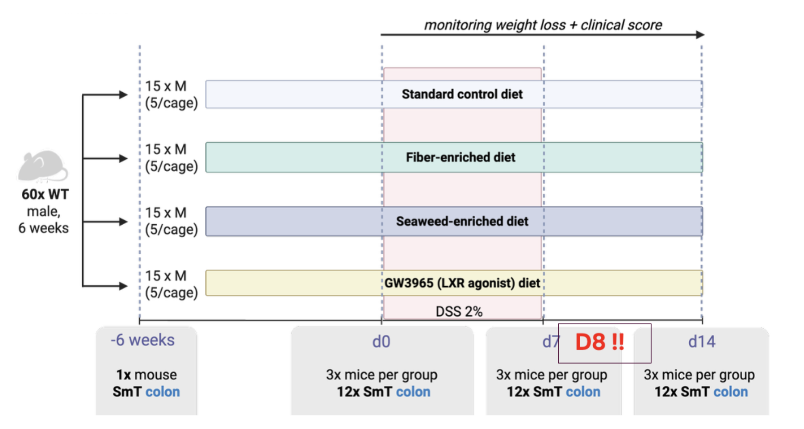
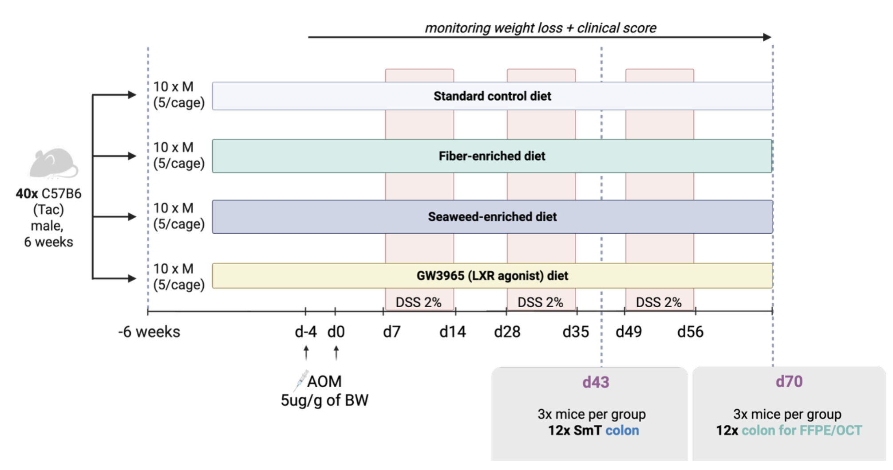

# Definitions and concepts

* Definition of niche: co-occurrence of host and microbial features in a region of space. Ideally, this would have functional implications, but we cannot test it with our data. 
* This can be thought as a process of embedding spots in a space that is based on host (gene expression) and bacterial (bacterial abundance) features. 
* [Spatial metatranscriptomics](https://www.nature.com/articles/s41587-023-01979-2) (SmT):  a sequencing-based approach that leverages 16S/18S/ITS/poly-d(T) multimodal arrays for simultaneous host transcriptome- and microbiome-wide characterization of tissues at 55-µm resolution

](asets/smt.png){#fig-smt}

# Problem formulation

* Unsupervised classification of spots: categorizing spots in discrete categories based on the gene expression and the bacterial abundance. 
* Modalities: gene expression, bacterial abundance, hematoxylin & eosin staining with spatial coordinates (grid of points). 

# Description of the data

**Dimensions**: 
    
* Host: 20,000 features (genes) → 10,000 - 15,000 after filtering. We can identify gene function for host part.
* Microbiome: 2000 features (bacterial genus) → around 100 after filtering. Not possible to identify bacterial function.
* The output of the SmT experiments correspond to:
    - H&E image
    - host genes count matrix (list of genes x spatial barcodes; the counts in the matrix correspond to number of unique transcripts of that gene)
    - bacterial count matrices (matrices at different taxonomic level: specie, genus, phylum; list of bacteria x spatial barcodes; the counts correspond to number of unique reads attributed to a specific taxa)
    - eukaryotic (fungal) count matrices (matrices at different taxonomic level: specie, genus, phylum; list of fungi x spatial barcodes; the counts correspond to number of unique reads attributed to a specific taxa)

**Published data**: other technologies have been created to profile bacterial abundance and host transcriptome in space. In the context of the murine gut, we can highlight:

- SHM-seq: 100 µm diameter barcoded spots separated by 200 µm, capture of bacterial RNA using probes against 16s rRNA.
- In situ polyadenylation: poly adenylation of total RNA to capture in poly-T platforms (Visium, Stereo-seq).
- Stereoseq v2.

**Labels**: no ground truth, definition of clusters that are stable across samples (stable co-occurrence of host and microbial features). 

Types of samples:

- Transverse sections: the colon is sectioned perpendicular to the longitudinal axis. Both luminal content and host tissue are profiled at an specific point of the colon length. 
- Rolls: the colon is open longitudinally and rolled. The whole tissue is profiled along the longitudinal axis, but luminal content is mostly absent. 

# Current status

## Mouse colitis project

Application of the Spatial 

| Number of mice / sections |Condition|
|---|---|
|1 mice: 5 tissue sections (distal-proximal colon) | Steady state
|1 mice: 2 tissue section (distal-proximal colon) | Germ free mice
|1 mice: 4 tissue sections (distal-proximal colon) | Hamburg microbiota
|1 mice: 4 tissue sections (distal-proximal colon) | Yale microbiota
|1mice: 4 tissue sections (distal-proximal colon) | Germ free mice

## KTH FOOD

The KTH FOOD initiative investigates how different diets influence host-microbiome interactions in gut health and disease. 

The study comprises two controlled mouse models: an inflamatory bowel disease (DSS-colitis) [60 mice; 61 tissue sections] and a colorectal cancer (CRC) [40 mice; 30 tissue sections] model, each including four dietary groups (standard control, fiber-enriched, seaweed-enriched, and a standard diet supplemented with the LXR agonist GW3965, which reduces inflammation and is therefore used as a positive control). 

For the DSS-colitis model, colon tissues have been collected at defined pre-disease, disease, and recovery stages to distinguish baseline dietary effects from disease-associated changes. 

{#fig-dss}

For the CRC model, just the acute disease timepoint has been samples. 

{#fig-crc}

The main technique used in this dataset is Spatial metaTranscriptomics, which simultaneously captures host mRNA, microbial 16S and fungal ITS profiles in tissue sections.

As of the current date, SmT data is still under processing. Due to heavy computational resources requirements, just 15 samples have been processed (most of them belonging to the CRC group).

# Open questions

* What state of analysis is needed to start the AI part?
* Should we use gene expression as it is, or derive features from it? E.g. pathway activity, cell type proportions.

# Sample overview

| Dataset | Mice / patients | Tissue | Condition / diet | Timepoint |
|---|---|---|---|---|
| Mouse colitis | 1 | 5 tissue sections (distal-proximal colon) | Steady state | – |
| Mouse colitis | 1 | 2 tissue sections (distal-proximal colon) | Germ free | – |
| Mouse colitis | 1 | 4 tissue sections (distal-proximal colon) | Hamburg microbiota | – |
| Mouse colitis | 1 | 4 tissue sections (distal-proximal colon) | Yale microbiota | – |
| Mouse colitis | 1 | 4 tissue sections (distal-proximal colon) | Germ free | – |
| KTH FOOD – CRC | 1 | 3x colon segments | GW diet | Naive |
| KTH FOOD – CRC | 2 | 3x colon segments | GW diet (6w after diet) | D0 |
| KTH FOOD – CRC | 2 | 3x colon segments | STD diet (6w after diet) | D0 |
| KTH FOOD – CRC | 1 | 3x colon segments | Fibre diet (6w after diet) | D0 |
| KTH FOOD – CRC | 1 | 3x colon segments | Seaweed diet (6w after diet) | D0 |
| KTH FOOD – CRC | 3 | 3x colon segments | STD diet | D43 |
| KTH FOOD – CRC | 3 | 3x colon segments | GW diet | D43 |
| KTH FOOD – CRC | 3 | Colon swiss roll | STD diet | D43 |
| KTH FOOD – CRC | 3 | Colon swiss roll | GW diet | D43 |
| KTH FOOD – CRC | 3 | Colon swiss roll | Fibre diet | D43 |
| KTH FOOD – CRC | 3 | Colon swiss roll | Seaweed diet | D43 |
| KTH FOOD – DSS | 1 | Colon swiss roll | GW diet | Naive |
| KTH FOOD – DSS | 1 | Colon swiss roll | Fibre diet | Naive |
| KTH FOOD – DSS | 3 | Colon swiss roll | STD diet | D0 |
| KTH FOOD – DSS | 3 | Colon swiss roll | GW diet | D0 |
| KTH FOOD – DSS | 3 | Colon swiss roll | Fibre diet | D0 |
| KTH FOOD – DSS | 3 | Colon swiss roll | Seaweed diet | D0 |
| KTH FOOD – DSS | 3 | Colon swiss roll | STD diet | D7 |
| KTH FOOD – DSS | 3 | Colon swiss roll | GW diet | D7 |
| KTH FOOD – DSS | 3 | Colon swiss roll | Fibre diet | D7 |
| KTH FOOD – DSS | 3 | Colon swiss roll | Seaweed diet | D7 |
| KTH FOOD – DSS | 3 | Colon swiss roll | STD diet | D14 |
| KTH FOOD – DSS | 4 | Colon swiss roll | GW diet | D14 |
| KTH FOOD – DSS | 2 | Colon swiss roll | Fibre diet | D14 |
| KTH FOOD – DSS | 5 | Colon swiss roll | Seaweed diet | D14 |
| Neonatal atrasia cohort | 6 patients | Colon / SI biopsies |
| UC patients | - | Colon | Ulcerative colitis | - |

: Overview of the available samples per dataset. {#tbl-samples}

# Related papers

Other papers in niche definition using only host features. 

- [Nicheformer: a foundation model for single-cell and spatial omics](https://www.nature.com/articles/s41592-025-02814-z)

- [Novae: a graph-based foundation model for spatial transcriptomics data](https://www.nature.com/articles/s41592-025-02899-6)

- [Quantitative characterization of cell niches in spatially resolved omics data](https://www.nature.com/articles/s41588-025-02120-6)

- [CellNiche represents cellular microenvironments in atlas-scale spatial omics data with contrastive learning](https://www.nature.com/articles/s41467-026-71759-4)
